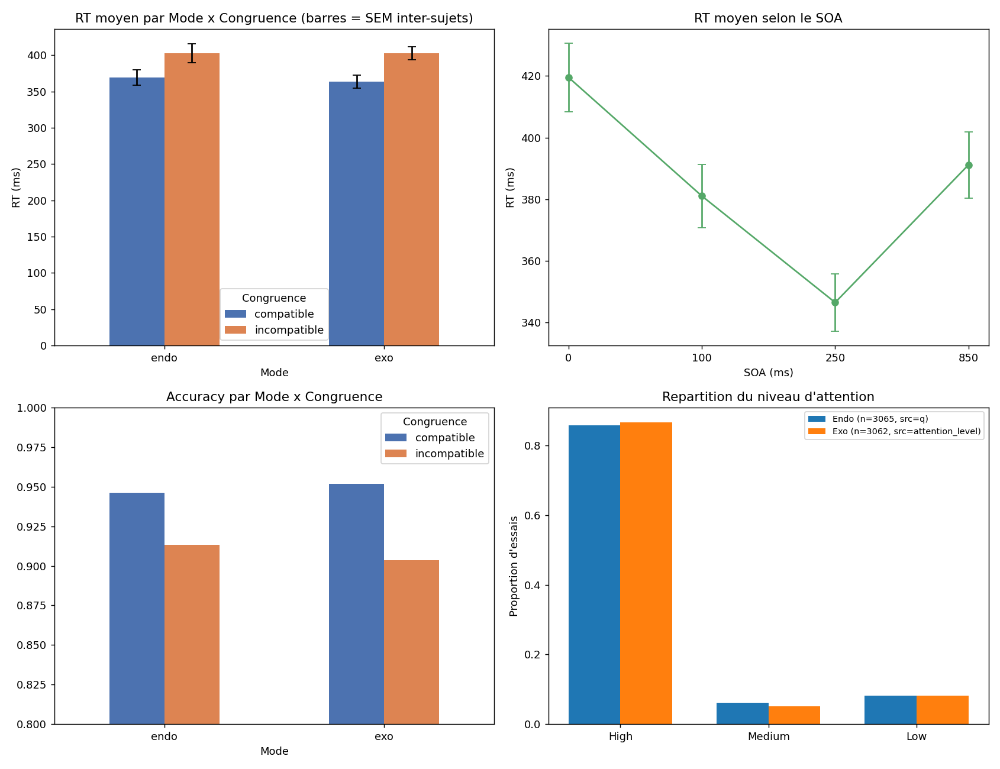

# EEG–fNIRS Attention Decoding: a held-out-subject evaluation

Can single-trial EEG and fNIRS features predict behaviour in an attention task **beyond what the experimental design already tells you**, on subjects the model has never seen?

This repository is the pipeline and the (deliberately conservative) answer, built during a research internship at **Acti-Sens Lab** (research association affiliated with the LINP2 lab, Université Paris Nanterre). It covers feature extraction, a leakage-safe machine-learning baseline, and a statistically disciplined evaluation on a 24-subject EEG–fNIRS dataset.

> **Headline result.** With 24 subjects, EEG/fNIRS features do **not** predict reaction time better than a design-only baseline (pre-registered test: Wilcoxon p = 0.46 on MAE). The one effect that survives FDR correction is that **trial congruence is decodable above chance** from the signal (AUC 0.538 ± 0.040, FDR-corrected p = 0.003). The signal contains information about the trial type, but not exploitable information about trial-by-trial speed at this sample size.

## Why this repo is built the way it is

Most single-subject EEG decoding results look good because trials from the same subject leak across train and test. This project was built to avoid that and to report what is left.

| Concern | What the pipeline does |
|---|---|
| Subject leakage | Leave-One-Subject-Out (24 outer folds); never a random row split |
| Hyperparameter leakage | Nested CV: inner `GroupKFold` over training subjects, outer LOSO |
| Is the brain signal adding anything? | Compared against a **design-only floor** (SOA) and a train-mean baseline, not against zero |
| Collinearity | Exact-duplicate removal, plus hierarchical clustering on \|Spearman\| > 0.9 computed on each training fold only |
| Multiple comparisons | One pre-designated confirmatory test; everything else labelled exploratory and Benjamini–Hochberg corrected |
| Unstable per-subject R² | Paired tests on per-subject MAE as well as R² |
| Imbalanced accuracy target (93/7) | AUC with `class_weight='balanced'` |

## Results (24 subjects, LOSO, "fast" profile)

Data: 5,888 paired EEG+fNIRS trials, 5,863 after dropping NaNs.

**Confirmatory (pre-designated, uncorrected):** fusion (EEG + fNIRS + SOA) vs. SOA-only floor on RT.

| Model | R² (LOSO) | median |
|---|---|---|
| Fusion EEG + fNIRS + SOA | −0.180 ± 0.389 | −0.089 |
| SOA-only floor | −0.205 ± 0.524 | −0.055 |

Paired Wilcoxon: R² p = 0.79, MAE p = 0.46. Mean MAE 85.7 ms (fusion) vs 86.8 ms (train-mean baseline). The inner CV picked `max_depth=6, min_samples_leaf=20` in all 24 folds, so this is not a tuning problem.

**Exploratory (BH-FDR corrected):**

| Comparison | Δ mean | p | p (FDR) | Significant |
|---|---|---|---|---|
| RT: EEG+SOA vs floor (MAE) | +0.79 ms | 0.456 | 0.628 | no |
| RT: fNIRS+SOA vs floor (MAE) | +0.08 ms | 0.061 | 0.182 | no |
| RT: fusion vs floor (Ridge, MAE) | +8.47 ms | 0.966 | 0.966 | no |
| Accuracy: fusion vs floor (AUC) | +0.030 | 0.128 | 0.256 | no |
| **Congruence: AUC vs chance** | **+0.038** | **0.0005** | **0.0030** | **yes** |
| Mode (endo/exo): AUC vs chance | +0.025 | 0.524 | 0.628 | no |

Full numbers are in [`results/`](results/). Detailed reading and caveats: [`docs/METHODOLOGY.md`](docs/METHODOLOGY.md).

### Task behaviour sanity check



RT shows the expected congruence cost and a U-shaped SOA effect, so the behavioural data behave as the attention literature predicts.


## Bugs found and fixed along the way

Running the code end to end on real data surfaced five real bugs (details in the methodology doc). The two that matter most for science:

- **`LPC` and `ConflictSP` were byte-identical columns** (max difference 0.0 over 6,144 rows), not just highly correlated. Keeping both inflated the ERP feature count (8 → 7) and halved their apparent random-forest importance. They are now de-duplicated automatically.
- **Energy and Peak-to-Peak were not band-filtered** in the public toy pipeline, so all five bands carried identical values. Fixed with a 4th-order zero-phase Butterworth band-pass before computing both.

## Repository layout

```
notebooks/
  01_feature_extraction.ipynb              # per-subject EEG spectral/FRN + fNIRS (mBLL -> HbO/HbR) features
  02_ml_baseline_held_out_subject.ipynb    # held-out-subject baseline: EEG vs fNIRS vs fusion vs design floor
src/
  analyse_descripteurs_v2.py               # behavioural + descriptor analysis, figures
  adapter_prive_level3_v2.py               # nested LOSO evaluation, FDR, convergence analysis
  pipeline_public_toy_v2.py                # reproduces the EEG feature family from raw signal
results/                                   # confirmatory, exploratory (FDR), importances, per-subject scores
figures/
docs/METHODOLOGY.md
```

## Data

**No data is included in this repository.** The scripts expect:

- Notebook 01: per-subject `subN.mat`, `subN_tsk.mat`, `subN.nirs` from an open-access EEG–fNIRS attention dataset in a folder pointed to by `EEG_FNIRS_DATA_DIR`.
- `src/analyse_descripteurs_v2.py` and `src/adapter_prive_level3_v2.py`: the lab's merged descriptor tables (`Descripteurs_fNIRS.csv`, `Descripteurs_EEG_Globaux.csv`, and the endo/exo labelled spreadsheets). These come from the lab's own recordings and are not public.

## Running it

```bash
pip install -r requirements.txt

# notebooks
export EEG_FNIRS_DATA_DIR=/path/to/data
jupyter lab notebooks/

# scripts (profile: smoke | fast | full)
python src/analyse_descripteurs_v2.py path/to/dataset/
python src/adapter_prive_level3_v2.py path/to/dataset/ fast
OUTDIR=out python src/pipeline_public_toy_v2.py toy_eeg.csv out/
```

`fast` (default, about 20 min on one core) produced the reported numbers. `full` uses the complete grid, 500 trees and 5 inner folds and should be run before any submission. `smoke` is an end-to-end check only; its results are not interpretable.

## Limitations

- **N = 24.** Effects are small and per-subject R² is unstable. Report medians and MAE, not just mean R².
- **fNIRS contributes nothing in this model** (importance ≈ 0). Averaging HbO/HbR over 12 channels almost certainly destroys spatial specificity. This is a limit of the feature engineering, not evidence that fNIRS is uninformative.
- **Results are from the `fast` profile**, not yet re-run in `full`.
- **Mode decoding caveat.** Endo and exo are probably recorded in separate blocks, so above-chance Mode decoding could reflect session drift rather than cognition. Not an issue now (not significant), but needs a block-wise control if it becomes significant.
- **EEG channel order** in the toy pipeline (`O2, O1, CP2, CP1, CP6, CP5, AF8, AF7`) is an assumption not yet verified against the montage table.
- Source code comments are in French (the lab's working language); the docs are in English.

## Roadmap

Part of a staged plan: feature extraction → classical ML baseline (this repo) → state-space model → EEG→fNIRS encoding → Dynamic Gating fusion → SHAP-based explanation, moving toward hypothesis-driven analyses (Mode × SOA × Congruence mixed models, CNV/LPC/conflict slow-potential windows, HbO + HbR).

## Acknowledgements

Supervision by Badr Mouazen and the Acti-Sens Lab team; scientific direction from the LINP2 lab (Université Paris Nanterre).
