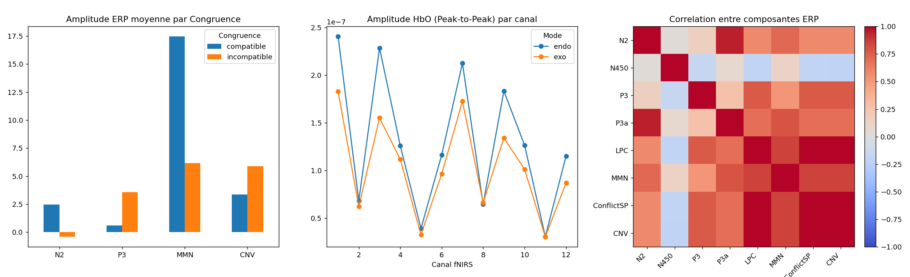

# EEG–fNIRS Attention Decoding: from a public-data prototype to a rigorous evaluation on lab data

Can single-trial EEG and fNIRS features predict behaviour in an attention task **beyond what the experimental design already tells you**, on subjects the model has never seen?

This repository documents how I tried to answer that question during a research internship at **Acti-Sens Lab** (research association affiliated with the LINP2 lab, Université Paris Nanterre). It follows two stages on two datasets, and keeps the mistakes I found along the way visible, because they are part of the result.

## The project in one picture

| | Stage 1: public dataset (prototype) | Stage 2: lab dataset (target) |
|---|---|---|
| **Why** | The lab's own recordings were not ready yet, so I built and tested the pipeline on open data | The real question: attention modes (endogenous vs exogenous) in the lab's EEG–fNIRS task |
| **Task** | Visuomotor target identification with a variable SOA of about 2–5 s | Attention task: Mode (endo/exo) × Congruence × SOA (0, 100, 250, 850 ms) |
| **Size** | 48 subjects with complete files, 48,397 trials | 24 subjects, 5,888 paired trials (5,863 after NaN removal) |
| **What I did** | Feature extraction, per-subject QC, held-out-subject ML baseline | Re-did the evaluation with nested leave-one-subject-out CV, a design-only floor, and FDR correction |
| **Where** | [`notebooks/public_dataset/`](notebooks/public_dataset) | [`src/private_dataset/`](src/private_dataset), [`results/private_dataset/`](results/private_dataset) |

**Why two stages?** Stage 1 told me what was wrong with my own first-pass evaluation. Stage 2 is the corrected version, run on the data that matters.

## Results

### Stage 2: lab dataset (24 subjects, leave-one-subject-out)

**Headline.** EEG/fNIRS features do **not** predict reaction time better than a design-only baseline (pre-designated test: Wilcoxon p = 0.46 on MAE). The one effect that survives FDR correction is that **trial congruence is decodable above chance** (AUC 0.538 ± 0.040, FDR-corrected p = 0.003). The signal carries information about trial type, but not exploitable information about trial-by-trial speed at this sample size.

**Confirmatory (pre-designated, uncorrected):** fusion (EEG + fNIRS + SOA) vs SOA-only floor on RT.

| Model | R² (LOSO) | median |
|---|---|---|
| Fusion EEG + fNIRS + SOA | −0.180 ± 0.389 | −0.089 |
| SOA-only floor | −0.205 ± 0.524 | −0.055 |

Paired Wilcoxon: R² p = 0.79, MAE p = 0.46. Mean MAE is 85.7 ms (fusion) vs 86.8 ms (train-mean baseline). The inner CV picked `max_depth=6, min_samples_leaf=20` in all 24 folds, so tuning is not the issue.

**Exploratory (Benjamini–Hochberg corrected):**

| Comparison | Δ mean | p | p (FDR) | Significant |
|---|---|---|---|---|
| RT: EEG+SOA vs floor (MAE) | +0.79 ms | 0.456 | 0.628 | no |
| RT: fNIRS+SOA vs floor (MAE) | +0.08 ms | 0.061 | 0.182 | no |
| RT: fusion vs floor (Ridge, MAE) | +8.47 ms | 0.966 | 0.966 | no |
| Accuracy: fusion vs floor (AUC) | +0.030 | 0.128 | 0.256 | no |
| **Congruence: AUC vs chance** | **+0.038** | **0.0005** | **0.0030** | **yes** |
| Mode (endo/exo): AUC vs chance | +0.025 | 0.524 | 0.628 | no |

Full reading and caveats: [`docs/METHODOLOGY_PRIVATE_DATASET.md`](docs/METHODOLOGY_PRIVATE_DATASET.md).


RT shows the expected congruence cost and a U-shaped SOA effect, so the behavioural data behave as the attention literature predicts.



### Stage 1: public dataset (prototype), and why its numbers should not be quoted

The pipeline ran on 48 of the 50 subjects (the other two lack a complete file set) and produced 48,397 trials with EEG band power, spectral entropy, frontal negativity (FRN), HbO/HbR and a hazard-function reference for SOA. The held-out-subject baseline did **not** beat a design-only floor, but the numbers are not interpretable as they stand:

- Held-out-subject R² swings from −0.001 to −657 across five folds (mean −314). A spread like that points to a few subjects with extreme reaction times dominating the squared error, not to "no signal".
- The single-split MAE is 1.12 on an RT scale where typical values are about 0.3 (seconds).
- The foreperiod sanity check came out flat (correlation between hazard and RT = −0.002, expected to be negative), which fits the same explanation.

**What this means:** the Stage 1 evaluation needs RT outlier handling and a robust metric (per-subject MAE with paired tests) before it can be read. Stage 2 uses exactly those tools. I have not re-run Stage 1 with them, and I haven't confirmed the outlier explanation, since that needs the raw data.

## What the evaluation design protects against

| Concern | What Stage 2 does |
|---|---|
| Subject leakage | Leave-One-Subject-Out (24 outer folds); never a random row split |
| Hyperparameter leakage | Nested CV: inner `GroupKFold` over training subjects, outer LOSO |
| Is the brain signal adding anything? | Compared against a design-only floor (SOA) and a train-mean baseline, not against zero |
| Collinearity | Exact-duplicate removal, plus hierarchical clustering on \|Spearman\| > 0.9 computed on each training fold only |
| Multiple comparisons | One pre-designated confirmatory test; the rest labelled exploratory and BH-corrected |
| Unstable per-subject R² | Paired tests on per-subject MAE as well as R² |
| Imbalanced accuracy target (93/7) | AUC with `class_weight='balanced'` |

## Bugs found and fixed along the way

Running the code end to end surfaced five real bugs (details in the methodology doc). The two that matter most:

- **`LPC` and `ConflictSP` were byte-identical columns** (max difference 0.0 over 6,144 rows), not just highly correlated. Keeping both inflated the ERP feature count (8 → 7) and halved their apparent random-forest importance. They are now de-duplicated automatically.
- **Energy and Peak-to-Peak were not band-filtered** in the toy signal pipeline, so all five bands carried identical values. Fixed with a 4th-order zero-phase Butterworth band-pass.

## Repository layout

```
notebooks/public_dataset/
  01_feature_extraction.ipynb              # per-subject QC + EEG spectral/FRN + fNIRS (mBLL -> HbO/HbR) features
  02_ml_baseline_held_out_subject.ipynb    # held-out-subject baseline: EEG vs fNIRS vs fusion vs design floor
src/private_dataset/
  analyse_descripteurs_v2.py               # behavioural + descriptor analysis, figures
  adapter_prive_level3_v2.py               # nested LOSO evaluation, FDR, convergence analysis
src/toy_signal/
  pipeline_toy_v2.py                       # reproduces the EEG feature family from a raw toy signal
results/private_dataset/                   # confirmatory, exploratory (FDR), importances, per-subject scores
figures/private_dataset/
docs/METHODOLOGY_PRIVATE_DATASET.md
```

## Data

**No data is included in this repository.**

- **Public dataset (Stage 1).** Zhang et al., *Simultaneous Dataset of Brain, Eye and Hand during Visuomotor Tasks*, Scientific Data 12, 189 (2025), [doi:10.1038/s41597-024-04227-7](https://doi.org/10.1038/s41597-024-04227-7). Data on OSF: [doi:10.17605/osf.io/cfdsz](https://doi.org/10.17605/osf.io/cfdsz). 50 healthy adults, EEG + fNIRS + eye tracking + EKG + joystick. The article is licensed CC BY-NC-ND 4.0, so download the data yourself rather than redistributing it. Notebook 01 expects `subN.mat`, `subN_tsk.mat` and `subN.nirs` in the folder named by `EEG_FNIRS_DATA_DIR`. The paper documents fNIRS as `.csv`/`.mat`, so you may need to convert to `.nirs` as the authors describe.
- **Lab dataset (Stage 2).** The scripts in `src/private_dataset/` use the lab's merged descriptor tables (`Descripteurs_fNIRS.csv`, `Descripteurs_EEG_Globaux.csv`, and the endo/exo labelled spreadsheets). These come from the lab's own recordings and are not public.

## Running it

```bash
pip install -r requirements.txt

# Stage 1 notebooks
export EEG_FNIRS_DATA_DIR=/path/to/public/data
jupyter lab notebooks/public_dataset/

# Stage 2 scripts (profile: smoke | fast | full)
python src/private_dataset/analyse_descripteurs_v2.py path/to/dataset/
python src/private_dataset/adapter_prive_level3_v2.py path/to/dataset/ fast
python src/toy_signal/pipeline_toy_v2.py toy_eeg.csv out/
```

`fast` (default, about 20 min on one core) produced the reported numbers. `full` uses the complete grid, 500 trees and 5 inner folds and should be run before any submission. `smoke` is an end-to-end check only.

## Limitations

- **N = 24** in Stage 2. Effects are small and per-subject R² is unstable, so report medians and MAE.
- **fNIRS contributes nothing in this model** (importance ≈ 0). Averaging HbO/HbR over 12 channels almost certainly destroys spatial specificity. This is a feature-engineering limit, not evidence that fNIRS is uninformative.
- **Stage 2 numbers come from the `fast` profile**, not yet re-run in `full`.
- **Stage 1 needs RT cleaning** before its numbers can be read (see above).
- **Mode decoding caveat.** Endo and exo are probably recorded in separate blocks, so above-chance Mode decoding could reflect session drift. Not an issue now (not significant), but it needs a block-wise control if it becomes significant.
- **EEG channel order** in the toy pipeline (`O2, O1, CP2, CP1, CP6, CP5, AF8, AF7`) is an assumption, not yet checked against the montage table.
- Code comments are in French (the lab's working language); the docs are in English.

## Roadmap

Feature extraction → classical ML baseline (this repo) → state-space model → EEG→fNIRS encoding → Dynamic Gating fusion → SHAP-based explanation, moving toward hypothesis-driven analyses (Mode × SOA × Congruence mixed models, CNV/LPC/conflict slow-potential windows, HbO + HbR).

## Acknowledgements

Supervision by Badr Mouazen and the Acti-Sens Lab team; scientific direction from the LINP2 lab (Université Paris Nanterre).
